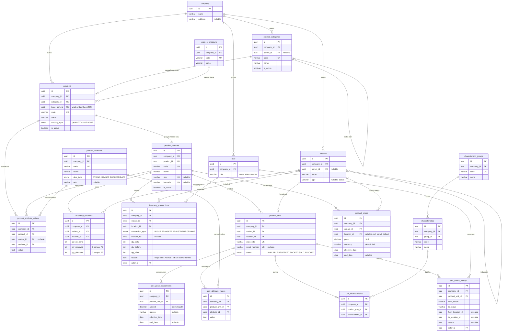

# Desain Product & Availability Management (P1)

- **Tanggal:** 2026-11-07
- **Status:** Draft, menunggu review
- **Sumber:** brief `Product Availability System.pptx`, ERD product management, `Universal_Product_Master_Database_Design.xlsx`, dan `backend/prisma/schema.prisma`

## Latar belakang

CRM saat ini mengelola lead, deal, aktivitas, dan kunjungan, tetapi belum punya pengelolaan produk yang bisa dipakai pengguna. Tabel `Item`, `Entry`, dan sejenisnya hanya memiliki CRUD generik dan tidak dipanggil frontend.

Fitur ini dirancang umum untuk berbagai industri, seperti trading, distributor, rental, dan properti. **Tidak ada tabel, kolom, atau aturan yang khusus untuk satu industri.** Perbedaan antar bisnis diatur lewat konfigurasi: kategori, satuan, tipe lokasi, atribut, karakteristik, dan metode pelacakan.

Perumahan dan beras pada dokumen ini hanya contoh untuk menguji konsep.

## Tujuan P1

1. Master data: kategori, satuan, hierarki lokasi, atribut, dan karakteristik.
2. Katalog produk dan varian dengan metode pelacakan kuantitas, unit, atau tanpa pelacakan.
3. Inventory kuantitas: stock in, stock out, transfer, adjustment, dan opname.
4. Inventory unit: registrasi, lokasi, karakteristik, dan status.
5. Availability yang dihitung otomatis, bukan diinput manual.
6. Harga dasar dan penyesuaian harga per unit.
7. Semua data terisolasi per company.

## Di luar cakupan

**P2, dikerjakan setelah P1:** reservasi, pembatalan, kedaluwarsa, approval, role lengkap, layar riwayat, dan laporan.

**Belum direncanakan:**
- Promo, yang ada di ERD tetapi tidak ada di brief.
- Hubungan produk dengan lead dan deal. `LeadItem` dihapus dan dirancang ulang saat P2.
- Purchase order, invoice, pembayaran, dan konversi antar satuan.

Desain P1 harus menyiapkan P2 tanpa membangunnya. Karena itu `qty_reserved`, `qty_allocated`, dan status unit `RESERVED` serta `BOOKED` sudah ada walau belum ada alur yang mengisinya.

## Keputusan desain

| No | Keputusan | Alasan |
| --- | --- | --- |
| 1 | `Tenant` diganti menjadi `Company`, dikerjakan lebih dulu dalam PR terpisah | Sesuai istilah bisnis. Biayanya paling rendah selagi masih dev. |
| 2 | `Item`, `ItemCategory`, `InventorySlot`, `GridConfig`, `Entry`, `Operation`, `Record`, dan `LeadItem` diganti | Tidak ada pemakaian dari frontend. Syarat: isinya sudah dicek kosong atau boleh hilang. |
| 3 | `Location` dipertahankan dan dikembangkan | Sudah dipakai Lead, Viewing, dan `use-locations`. |
| 4 | Kategori dan lokasi berada di tabel terpisah | Brief memisahkan keduanya, dan foreign key mencegah salah tautan. |
| 5 | Varian datar, tanpa `parent_id` | Brief hanya mengenal Product Type/Variant satu tingkat. Filter lebih mudah. |
| 6 | Varian dan karakteristik terpisah | Aturan brief. Varian adalah jenis yang ditawarkan. Karakteristik melekat pada unit, dan satu unit bisa punya banyak. |
| 7 | Setiap produk punya minimal satu varian | Stok, unit, dan harga selalu menunjuk varian. Produk tanpa variasi otomatis mendapat varian `Default`. |
| 8 | ID memakai UUID, harga memakai `DECIMAL(18,2)`, mata uang default `IDR` | Mengikuti pola kode saat ini, dan cukup untuk barang bernilai tinggi. |
| 9 | `tracking_type` terkunci setelah produk punya saldo, mutasi, atau unit | Satu produk hanya punya satu metode. Migrasi metode di luar cakupan P1. |
| 10 | Tidak ada tabel detail per industri | `property_unit_details` dari dokumen sumber diganti atribut dan karakteristik. |
| 11 | Endpoint baru bersifat khusus, bukan CRUD generik | Aturan stok tidak bisa ditegakkan lewat CRUD generik. |
| 12 | Hak akses P1: `owner` menulis, `member` membaca | Role lengkap baru dibutuhkan bersama approval di P2. |

## Perubahan dari skema dan ERD lama

### Schema Prisma saat ini

| Tabel lama | Tindakan | Pengganti |
| --- | --- | --- |
| `tenant` | Ganti nama (Fase 1) | `company`, ditambah kolom `address` |
| `item` | Hapus | `products` dan `product_variants` |
| `item_category` | Hapus | `product_categories` |
| `inventory_slot` | Hapus | `location` yang bertingkat |
| `grid_config` | Hapus | Tidak ada |
| `entry` | Hapus | `inventory_balances` |
| `operation`, `record` | Hapus | `inventory_transactions` |
| `lead_item` | Hapus | Dirancang ulang saat P2 |
| `location` | Kembangkan | Tambah `parent_id` dan `type` |
| `viewing` | Hapus kolom `slot_id` | Tidak ada |

Tabel CRM lainnya tidak berubah. Ikut dibersihkan: daftar model di `backend/src/index.ts`, aturan di `GenericUseCases.ts`, validasi dan DTO viewing, tipe `slotId` di frontend, serta test terkait.

### ERD product management sebelumnya

| Tabel di ERD | Tindakan | Perubahan |
| --- | --- | --- |
| `company` | Tetap | |
| `product_categories` | Ubah | Tambah `company_id`, `code`, `sort_order`, `is_active` |
| `product` | Ubah menjadi `products` | Tambah `company_id`, `category_id`, `base_uom_id`, `code`, `description`, `is_active`. `type` menjadi `tracking_type` dengan nilai `NONE`. Hapus baris placeholder. |
| `product_variants` | Ubah | Tambah `code`, `sku`, `barcode`, `is_active`. Pindahkan `base_price` ke `product_prices`. |
| `locations` | Ubah menjadi `location` | Tambah `type`. Hapus tabel duplikat di sisi kanan. |
| `units` | Ubah menjadi `product_units` | Tambah `serial_number`, `notes`. Status menjadi `AVAILABLE`, `RESERVED`, `BOOKED`, `SOLD`, `BLOCKED`. `location_id` wajib. Hapus `name`, dan pindahkan `characteristic` ke tabel sendiri. |
| `inventory_balances` | Tetap | `qty_reserved` dan `qty_allocated` bernilai 0 sampai P2 |
| `price_log` | Hapus | Diganti `product_prices` dan `unit_price_adjustments` |
| `promotions` | Tunda | Belum direncanakan |
| `deals`, `leads` | Tidak dibuat | Memakai tabel CRM yang ada. Relasi deal ke unit dibuat saat P2. |

Tabel baru: `units_of_measure`, `product_attributes`, `product_attribute_values`, `characteristic_groups`, `characteristics`, `unit_characteristics`, `unit_attribute_values`, `inventory_transactions`, `unit_status_history`, `product_prices`, dan `unit_price_adjustments`.

Perbaikan lain dari ERD: harga memakai `decimal`, bukan `int`. `company_id` ada di semua tabel. Contoh data unit memakai lokasi blok, bukan proyek. Kategori minyak memakai induk sembako, bukan beras.

## Model data

### Diagram ERD

Versi gambar lengkap dengan catatan dan contoh data: [PNG](2026-11-07-product-management-erd.png), [SVG](2026-11-07-product-management-erd.svg).

Diagram Mermaid di bawah adalah ringkasannya. Kolom `created_at` dan `updated_at` tidak digambarkan. Tabel CRM lain yang memakai `location`, seperti `lead` dan `viewing`, juga tidak digambarkan.

Penanda `UK` berarti unik per company, kecuali `characteristics.code` yang unik per grup. Semua tabel di diagram selain `company` terhubung ke `company` lewat `company_id`, tetapi garisnya hanya digambar untuk empat tabel agar diagram tetap terbaca.

### Detail tabel

Semua tabel memiliki `id` (UUID), `company_id` (wajib, foreign key ke `company`), dan `created_at`. Tabel yang datanya bisa diubah juga memiliki `updated_at`. Kolom tersebut tidak diulang di bawah.

### Master data

**`product_categories`**: `parent_id` (nullable, tanpa siklus), `code` (unik per company), `name`, `sort_order`, `is_active`.

**`units_of_measure`**: `code` (unik per company), `name`, `description` (nullable).

**`location`** dikembangkan dengan kolom berikut. Kolom yang sudah ada tetap.

| Kolom | Tipe | Aturan |
| --- | --- | --- |
| `parent_id` | UUID, nullable | Foreign key ke tabel ini. Tidak boleh membentuk siklus. |
| `type` | VARCHAR(30), nullable | Teks bebas per company, misalnya `WAREHOUSE`, `RACK`, `BIN`, `PROJECT`, `BLOCK`, `BRANCH` |

Kolom baru nullable agar lokasi yang sudah ada tetap valid.

**`product_attributes`**: spesifikasi produk atau varian. `code` (unik per company), `name`, `data_type` (`STRING`, `NUMBER`, `BOOLEAN`, `DATE`), `unit` (nullable), `is_active`.

**`characteristic_groups`**: `code` (unik per company), `name`, `is_active`. Contoh: Posisi, Kondisi, Warna.

**`characteristics`**: `group_id`, `code` (unik per grup), `name`, `is_active`. Contoh: Hook, Corner, Bekas.

### Katalog

**`products`**

| Kolom | Tipe | Aturan |
| --- | --- | --- |
| `category_id` | UUID | Foreign key ke `product_categories` |
| `base_uom_id` | UUID, nullable | Wajib untuk `QUANTITY` |
| `code` | VARCHAR(100) | Unik per company |
| `name` | VARCHAR(200) | |
| `tracking_type` | ENUM | `QUANTITY`, `UNIT`, `NONE`. Lihat keputusan 9. |
| `description` | TEXT, nullable | |
| `is_active` | BOOLEAN | Default true |

**`product_variants`**: `product_id`, `code` (unik per company), `name`, `sku` dan `barcode` (nullable, unik per company jika diisi), `is_active`.

**`product_attribute_values`**: `product_id`, `variant_id` (nullable, null berarti level produk), `attribute_id`, `value` (TEXT). Varian harus milik produk yang sama, dan `value` divalidasi sesuai `data_type`.

### Inventory kuantitas

**`inventory_balances`**

| Kolom | Tipe | Aturan |
| --- | --- | --- |
| `variant_id`, `location_id` | UUID | Unik bersama `company_id` |
| `qty_on_hand` | INT | Minimal 0 |
| `qty_reserved` | INT | Minimal 0. Selalu 0 sampai P2. |
| `qty_allocated` | INT | Minimal 0. Selalu 0 sampai P2. |

**`inventory_transactions`**: hanya bisa ditambah, tidak bisa diubah atau dihapus.

| Kolom | Tipe | Aturan |
| --- | --- | --- |
| `variant_id`, `location_id` | UUID | |
| `transaction_type` | ENUM | `IN`, `OUT`, `TRANSFER_OUT`, `TRANSFER_IN`, `ADJUSTMENT`, `OPNAME` |
| `transfer_ref` | UUID, nullable | Menghubungkan kedua baris transfer |
| `qty_delta` | INT | |
| `qty_before`, `qty_after` | INT | Nilai `qty_on_hand` |
| `reference` | VARCHAR(100), nullable | |
| `reason` | TEXT, nullable | Wajib untuk `ADJUSTMENT` dan `OPNAME` |
| `actor_id` | UUID | Foreign key ke `user` |

Pencatatan transaksi dan riwayat status sudah berjalan sejak P1 karena wajib menurut aturan brief. Yang ditunda ke P2 hanya layar riwayat dan laporannya.

### Inventory unit

**`product_units`**: hanya untuk produk `tracking_type = UNIT`.

| Kolom | Tipe | Aturan |
| --- | --- | --- |
| `variant_id` | UUID | Foreign key ke `product_variants` |
| `location_id` | UUID | Foreign key ke `location` |
| `unit_code` | VARCHAR(100) | Unik per company |
| `serial_number` | VARCHAR(100), nullable | Unik per company jika diisi |
| `status` | ENUM | `AVAILABLE`, `RESERVED`, `BOOKED`, `SOLD`, `BLOCKED` |
| `notes` | TEXT, nullable | |

**`unit_characteristics`**: `product_unit_id`, `characteristic_id`. Kombinasinya unik.

**`unit_attribute_values`**: `product_unit_id`, `attribute_id`, `value`. Untuk nilai aktual per unit, misalnya luas tanah, nomor mesin, atau kapasitas.

**`unit_status_history`**: hanya bisa ditambah. `product_unit_id`, `from_status`, `to_status`, `from_location_id`, `to_location_id`, `reason`, `actor_id`.

### Harga

**`product_prices`**: harga dasar.

| Kolom | Tipe | Aturan |
| --- | --- | --- |
| `variant_id` | UUID | |
| `location_id` | UUID, nullable | Null berarti harga default. Jika diisi, berlaku untuk lokasi itu dan seluruh turunannya. |
| `price` | DECIMAL(18,2) | Tidak boleh negatif |
| `currency` | VARCHAR(10) | Default `IDR` |
| `effective_date` | DATE | |
| `end_date` | DATE, nullable | Tidak boleh sebelum `effective_date` |

**`unit_price_adjustments`**: penyesuaian per unit.

| Kolom | Tipe | Aturan |
| --- | --- | --- |
| `product_unit_id` | UUID | |
| `amount` | DECIMAL(18,2) | Boleh negatif |
| `reason` | VARCHAR(255), nullable | |
| `effective_date`, `end_date` | DATE | `end_date` nullable |

Harga tidak ditimpa. Revisi harga dibuat sebagai baris baru dengan periode baru. `price_log` dari ERD tidak dibuat karena tabel ini sudah menyimpan riwayatnya.

### Perubahan tabel lain

- `viewing.slot_id` dihapus, karena `InventorySlot` dihapus dan tidak ada form yang mengisinya.
- `company` mendapat kolom `address` yang nullable.

## Aturan bisnis

### Availability

| Metode | Perhitungan |
| --- | --- |
| Kuantitas | `qty_on_hand - qty_reserved - qty_allocated` per varian dan lokasi |
| Unit | Jumlah unit berstatus `AVAILABLE`. Status lain tidak dihitung. |
| Tanpa pelacakan | Tidak punya stok, sehingga tidak dihitung |

Availability dihitung saat dibaca dan tidak disimpan. Availability pada lokasi induk adalah jumlah dari seluruh lokasi turunannya.

### Inventory kuantitas

- Saldo hanya disimpan di lokasi paling spesifik, yaitu lokasi tanpa turunan.
- Lokasi yang menyimpan saldo atau unit tidak bisa diberi lokasi turunan.
- Stock out dan transfer tidak boleh melebihi availability.
- Transfer mengurangi lokasi asal dan menambah lokasi tujuan dalam satu transaksi database.
- Adjustment dan opname wajib punya alasan. Opname mencatat selisih antara hitungan fisik dan saldo.
- Setiap perubahan saldo menghasilkan record transaksi dalam transaksi database yang sama.
- Perubahan saldo memakai update bersyarat, sehingga dua permintaan bersamaan tidak bisa membuat stok negatif.

### Inventory unit

- Kode unit unik per company. Registrasi massal bisa membuat kode dari prefix dan nomor urut, dan seluruhnya gagal jika ada kode yang bentrok.
- Status awal unit adalah `AVAILABLE`.
- Selama reservasi belum ada, transisi manual di P1:

| Dari | Ke |
| --- | --- |
| `AVAILABLE` | `BLOCKED`, `SOLD` |
| `BLOCKED` | `AVAILABLE` |

- `RESERVED` dan `BOOKED` hanya akan diisi alur reservasi di P2. `SOLD` bersifat final, dan tidak ada transisi keluar darinya.
- Setiap perubahan status atau lokasi mencatat `unit_status_history`.
- Unit yang sudah `SOLD` tidak bisa dipindah atau dihapus.

### Pemilihan harga

Harga dasar diambil dari baris yang periodenya mencakup tanggal acuan, dengan urutan:

1. Harga pada lokasi barang, lalu naik ke lokasi induknya satu per satu.
2. Harga default varian (`location_id` null).

Untuk unit, harga akhir = harga dasar + penyesuaian yang berlaku. Contoh: harga dasar 350 juta + penyesuaian 25 juta = 375 juta. Hasil akhir tidak boleh negatif.

Jika harga dasar tidak ditemukan, API mengembalikan error yang jelas, bukan harga 0. Dua periode tumpang tindih pada kombinasi yang sama ditolak. MySQL tidak punya constraint untuk rentang tanggal, sehingga pengecekan dilakukan di dalam transaksi.

### Keamanan dan validasi

- `company_id` dan aktor selalu diambil dari JWT, tidak pernah dari body.
- Setiap ID relasi divalidasi milik company yang sama sebelum dipakai.
- Hanya produk `UNIT` yang boleh punya unit, dan hanya produk `QUANTITY` yang boleh punya saldo.
- Master yang sudah dipakai dinonaktifkan, tidak dihapus.

## API

Semua endpoint berada di `/api` dan membutuhkan autentikasi.

| Resource | Endpoint |
| --- | --- |
| Master | CRUD `/product-categories`, `/units-of-measure`, `/product-attributes`, `/characteristic-groups`, `/characteristics` |
| Produk | CRUD `/products`, `/products/:id/variants` |
| Inventory kuantitas | `GET /inventory/balances`, `GET /inventory/transactions`, `POST /inventory/stock-in`, `/stock-out`, `/transfers`, `/adjustments`, `/opnames` |
| Unit | CRUD `/product-units`, `POST /product-units/bulk`, `POST /product-units/:id/status`, `POST /product-units/:id/move` |
| Availability | `GET /availability?productId&variantId&locationId&status` |
| Harga | CRUD `/product-prices`, `/unit-price-adjustments`, `GET /product-prices/resolve?variantId&unitId&locationId&date` |

## Frontend

Mengikuti pola yang ada: TanStack Query, React Hook Form, Zod, dan komponen `components/ui`. Modul mengikuti navigasi brief, dengan nama yang netral dari industri.

- **Master Data:** kategori, satuan, hierarki lokasi, atribut, karakteristik.
- **Products:** `/products`, `/products/[id]`, dengan varian dan atribut.
- **Inventory:** `/inventory/quantity` untuk saldo dan transaksi, `/inventory/units` untuk daftar, registrasi, dan status.
- **Availability:** `/availability`, dengan filter produk, lokasi, dan status.
- **Pricing:** `/pricing`, dengan harga dasar, penyesuaian unit, dan alat cek harga.

Form produk menampilkan isian sesuai `tracking_type`. Setiap layar menangani kondisi loading, kosong, sukses, gagal validasi, tidak berwenang, dan error.

## Pengujian

- Unit test harga: setiap tingkat lokasi, periode, overlap, tidak ada harga, dan penyesuaian.
- Unit test inventory: semua jenis transaksi, stok tidak cukup, alasan wajib, dan aturan lokasi.
- Unit test status: transisi valid dan tidak valid, serta riwayat tercatat.
- Isolasi company: ID milik company lain ditolak di setiap endpoint.
- Konkurensi: dua stock out bersamaan pada stok terakhir, diuji dengan database sungguhan.
- Migrasi: dijalankan pada database kosong dan salinan database dev.

Skenario validasi browser, untuk membuktikan model yang sama melayani kedua bisnis tanpa kode khusus:

- **Trading:** Beras 5 kg, lokasi Warehouse A > Rak 01 > Bin 01, stok awal 500 pcs, lalu stock in, stock out, transfer, dan adjustment.
- **Properti:** dua proyek dengan masing-masing dua blok, satu tipe rumah dipakai bersama, harga berbeda per proyek, dan unit hook dengan penyesuaian harga.

Bagian "reserved quantity" pada skenario brief divalidasi saat P2.

## Risiko

| Risiko | Mitigasi |
| --- | --- |
| Tabel lama ternyata berisi data | Hitung baris di setiap environment sebelum migrasi |
| Migrasi rename dibuat Prisma sebagai drop dan create | Review SQL dan tulis `RENAME` secara manual |
| `Company` tertukar dengan `Organization` | Label UI yang jelas. `Organization` berarti perusahaan pelanggan. |
| Perubahan saldo melewati aturan | Saldo hanya berubah lewat use case inventory, dan route generik dihapus |
| Saldo berbeda dari riwayat | Tulis keduanya dalam satu transaksi, dan sediakan query rekonsiliasi |
| Istilah satu industri masuk ke UI atau kode | Review label, dan uji dengan kedua skenario |

## Untuk dikonfirmasi saat P2

Tiga hal ini ada di brief dan tidak memengaruhi P1, tetapi perlu dijawab sebelum P2:

1. Diagram 3 dan 5 membuat availability turun dua kali saat stok yang direservasi dialokasikan. Reservasi 20 lalu alokasi 20 mengurangi 40. Usulan: `qty_reserved` turun saat alokasi.
2. Diagram 4 mengarahkan unit yang batal ke `Reserved` atau `Blocked`, sedangkan Diagram 5 menyebut unit dilepas. Usulan: kembali ke `AVAILABLE`.
3. Reservasi memakai `Customer` yang ada dan bisa ditautkan ke `Deal` secara opsional.

## Keputusan P1 yang sudah disepakati

1. Keputusan 4, 5, dan 10 dipakai. Pembuat dokumen `Universal_Product_Master` tetap perlu diberi tahu karena ketiganya berbeda dari dokumennya.
2. Transisi manual `AVAILABLE` ke `SOLD` dibolehkan di P1, karena reservasi belum ada.
3. Impor unit dari file tidak termasuk P1. P1 cukup input manual dan registrasi massal dengan prefix.
