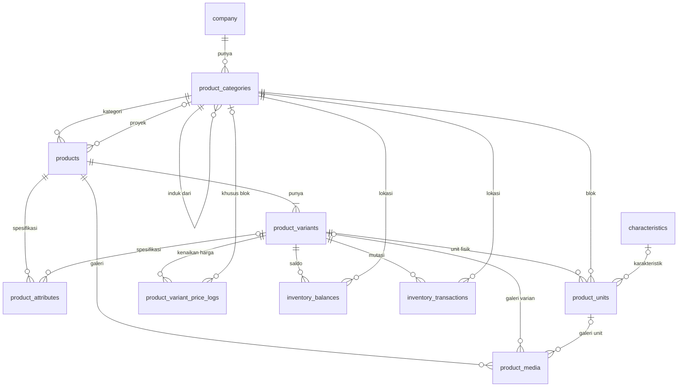

# Desain Product & Availability Management (P1)

- **Tanggal:** 2026-11-07, diperbarui 2026-11-10 mengikuti ERD tim
- **Status:** Draft, menunggu review
- **Sumber:** ERD product management tim, brief `Product Availability System.pptx`, dan `backend/prisma/schema.prisma`

## Latar belakang

CRM saat ini mengelola lead, deal, aktivitas, dan kunjungan, tetapi belum punya pengelolaan produk yang bisa dipakai pengguna. Tabel `Item`, `Entry`, dan sejenisnya hanya memiliki CRUD generik dan tidak dipanggil frontend.

Fitur ini dirancang umum untuk berbagai industri, seperti trading, distributor, rental, dan properti. **Tidak ada tabel, kolom, atau aturan yang khusus untuk satu industri.** Perbedaan antar bisnis diatur lewat konfigurasi: kategori, tipe lokasi, atribut, karakteristik, dan metode pelacakan.

Perumahan dan beras pada dokumen ini hanya contoh untuk menguji konsep.

## Tujuan P1

1. Kategori bertingkat yang sekaligus menjadi hierarki lokasi.
2. Katalog produk dan varian dengan metode pelacakan `QUANTITY` atau `UNIT`.
3. Spesifikasi produk dan varian lewat atribut, serta karakteristik unit.
4. Inventory kuantitas: stock in, stock out, transfer, adjustment, dan opname.
5. Inventory unit: registrasi, lokasi blok, karakteristik, dan status.
6. Availability dan harga akhir yang dihitung otomatis, bukan diinput manual.
7. Media produk: foto, dokumen, dan link video.
8. Semua data terisolasi per company.

## Di luar cakupan

**LATER, dari ERD tim:** `price_log`, `deals`, `leads`, dan `promotions`.

**LATER, dari usulan yang belum disepakati:** `product_unit_attributes` (nilai spesifikasi per unit), `unit_status_history`, `characteristic_groups`, `unit_characteristics` (banyak karakteristik per unit), dan satuan (`units_of_measure`).

**P2:** reservasi, pembatalan, kedaluwarsa, approval, role lengkap, layar riwayat, dan laporan.

Desain P1 harus menyiapkan P2 tanpa membangunnya. Karena itu `qty_reserved`, `qty_allocated`, dan status unit `RESERVED` serta `BOOKED` sudah ada walau belum ada alur yang mengisinya.

## Keputusan desain

| No | Keputusan | Alasan |
| --- | --- | --- |
| 1 | `Tenant` diganti menjadi `Company`, dikerjakan lebih dulu dalam PR terpisah | Semua tabel baru memakai `company_id`. Biayanya paling rendah selagi masih dev. |
| 2 | `Item`, `ItemCategory`, `InventorySlot`, `GridConfig`, `Entry`, `Operation`, `Record`, dan `LeadItem` dihapus | Tidak ada pemakaian dari frontend. Syarat: isinya sudah dicek kosong atau boleh hilang. |
| 3 | Kategori dan lokasi digabung di `product_categories`, dibedakan lewat `type` | Keputusan tim. Satu pohon untuk klasifikasi (`CATEGORY`) dan lokasi (`PROJECT`, `CLUSTER`, `BLOCK`, `WAREHOUSE`, `RACK`, `BIN`). |
| 4 | Tabel `location` lama tetap, khusus Lead dan Viewing | Sudah dipakai `use-locations`. Tidak disentuh fitur produk. |
| 5 | Produk adalah proyek. `products.project_category_id` menunjuk kategori `PROJECT` | Perumahan Green dan Perumahan Grand adalah dua produk. Type 36 dibuat per proyek, sehingga harga dasarnya cukup di varian. |
| 6 | `tracking_type` hanya `QUANTITY` atau `UNIT`, dan terkunci setelah produk punya saldo, transaksi, atau unit | Satu produk hanya punya satu metode. |
| 7 | `company.inventory_tracking_mode` (`QUANTITY_ONLY`, `UNIT_ONLY`, `BOTH`) membatasi `tracking_type` produk | Ditentukan di awal. Tidak bisa diubah jika masih ada produk yang tidak sesuai mode baru. |
| 8 | Harga dasar di `product_variants.base_price`. Kenaikan harga lewat `product_variant_price_logs` | Sesuai ERD tim. Log bisa berlaku untuk semua unit varian atau hanya satu blok. |
| 9 | Spesifikasi disimpan di `product_attributes` dengan nilai langsung di barisnya | Sesuai ERD tim. Tidak ada tabel definisi atribut terpisah. |
| 10 | Karakteristik satu tabel dengan kolom `group`. Satu unit punya paling banyak satu karakteristik | Sesuai ERD tim dan contoh datanya. |
| 11 | `current_price`, `stock`, dan status price log tidak disimpan | Selalu dihitung, sehingga tidak bisa berbeda dari sumbernya. |
| 12 | ID memakai UUID, harga memakai `DECIMAL(18,2)` | Mengikuti pola kode saat ini, dan cukup untuk barang bernilai tinggi. ERD tim memakai `int`. |
| 13 | Endpoint baru bersifat khusus, bukan CRUD generik | Aturan stok tidak bisa ditegakkan lewat CRUD generik. |
| 14 | Hak akses P1: `owner` menulis, `member` membaca | Role lengkap baru dibutuhkan bersama approval di P2. |
| 15 | Video disimpan sebagai link, bukan file | Batas upload 10 MB, dan disk server dipakai bersama aplikasi lain. |

## Perubahan dari ERD tim

| Bagian ERD tim | Perubahan | Alasan |
| --- | --- | --- |
| `company` | Tambah `inventory_tracking_mode` | Keputusan 7 |
| `product_categories.type` | Nilai menjadi `CATEGORY`, `PROJECT`, `CLUSTER`, `BLOCK`, `WAREHOUSE`, `RACK`, `BIN`. Tambah `slug` dan `sort_order`. | Keputusan 3 |
| `product` | Menjadi `products`. Tambah `project_category_id`. | Keputusan 5 |
| `product_variants` | Hapus `current_price` dan `stock`. Tambah `code`. `base_price` menjadi decimal. | Keputusan 11 dan 12 |
| `product_attributs` | Menjadi `product_attributes`. `variant_id` nullable, `data_type` tambah `BOOLEAN`, `value` menjadi `varchar`. | Atribut bisa di tingkat produk, dan nilainya tidak selalu angka. |
| `characteristics` | Tetap. `name` menjadi `varchar`. Ditautkan ke unit lewat `product_units.characteristic_id`. | ERD tim belum punya relasinya |
| `product_units` | Hapus `width` dan `height`, diganti atribut varian. `longitude` diperbaiki menjadi `latitude` dan `longitude`. Status tambah `BOOKED` dan `SOLD`. Tambah `adjustment_amount`, `adjustment_reason`, dan `characteristic_id`. | Contoh data tim memakai kolom dan status tersebut |
| `product_variant_price_logs` | Hapus `status`. Tambah `category_id` (nullable, blok). `end_date` nullable. | Status dihitung dari tanggal. Kenaikan per blok. |
| `product_media` | `file_size` menjadi `int`. Tambah `file_type` dan `sort_order`. | Ukuran file adalah angka |
| Contoh `product_variant_prices` dan `locations` | Tidak dibuat sebagai tabel | Digantikan `base_price` dan `product_categories` |
| Tabel baru | `inventory_balances` dan `inventory_transactions` | Saldo kuantitas per lokasi dan riwayatnya |

### Perubahan schema Prisma saat ini

| Tabel lama | Tindakan | Pengganti |
| --- | --- | --- |
| `tenant` | Ganti nama (Fase 1) | `company`, ditambah `address` dan `inventory_tracking_mode` |
| `item`, `item_category` | Hapus | `products`, `product_variants`, `product_categories` |
| `inventory_slot`, `grid_config` | Hapus | `product_categories` bertipe lokasi |
| `entry`, `operation`, `record` | Hapus | `inventory_balances`, `inventory_transactions` |
| `lead_item` | Hapus | Dirancang ulang bersama `deals` |
| `viewing.slot_id` | Hapus kolom | Tidak ada |
| `location` | Tetap | Dipakai Lead dan Viewing |

Ikut dibersihkan: daftar model di `backend/src/index.ts`, aturan di `GenericUseCases.ts`, validasi dan DTO viewing, tipe `slotId` di frontend, serta test terkait.

## Model data

Gambar lengkap dengan catatan dan contoh data: [PNG](2026-11-07-product-management-erd.png), [SVG](2026-11-07-product-management-erd.svg). Hijau berarti tambahan dari ERD tim, kuning berarti diubah.

Semua tabel memiliki `id` (UUID), `company_id` (wajib), `created_at`, dan `updated_at`. Kolom tersebut tidak diulang di bawah, dan tidak digambarkan di diagram.



### `company`

| Kolom | Tipe | Aturan |
| --- | --- | --- |
| `name` | VARCHAR | |
| `address` | VARCHAR, nullable | |
| `inventory_tracking_mode` | ENUM | `QUANTITY_ONLY`, `UNIT_ONLY`, `BOTH`. Default `BOTH`. |

### `product_categories`

| Kolom | Tipe | Aturan |
| --- | --- | --- |
| `parent_id` | UUID, nullable | Company sama, tanpa siklus |
| `name` | VARCHAR(150) | |
| `code` | VARCHAR(100) | Unik per company |
| `slug` | VARCHAR(150) | Unik per company |
| `type` | ENUM | `CATEGORY`, `PROJECT`, `CLUSTER`, `BLOCK`, `WAREHOUSE`, `RACK`, `BIN` |
| `siteplan_img` | TEXT, nullable | Biasanya untuk `PROJECT` |
| `sort_order` | INT | Default 0 |
| `is_active` | BOOLEAN | Default true |

### `products`

| Kolom | Tipe | Aturan |
| --- | --- | --- |
| `category_id` | UUID | Kategori bertipe `CATEGORY` |
| `project_category_id` | UUID, nullable | Kategori bertipe `PROJECT`. Wajib untuk produk `UNIT` yang unitnya berada di blok. |
| `name` | VARCHAR(200) | |
| `code` | VARCHAR(100) | Unik per company |
| `description` | TEXT, nullable | |
| `tracking_type` | ENUM | `QUANTITY`, `UNIT`. Harus diizinkan `inventory_tracking_mode`. |
| `is_active` | BOOLEAN | Default true |

### `product_variants`

`product_id`, `name`, `code` (unik per company), `base_price` (DECIMAL(18,2), tidak negatif). Setiap produk punya minimal satu varian.

### `product_attributes`

| Kolom | Tipe | Aturan |
| --- | --- | --- |
| `product_id` | UUID | |
| `variant_id` | UUID, nullable | Null berarti tingkat produk. Harus milik `product_id`. |
| `name`, `code` | VARCHAR | `code` unik per produk dan varian |
| `data_type` | ENUM | `NUMBER`, `STRING`, `BOOLEAN` |
| `value` | VARCHAR(255) | Divalidasi sesuai `data_type` |
| `unit` | VARCHAR(30), nullable | Misalnya `m²` |

### `characteristics`

`group` (VARCHAR, misalnya Posisi), `code` (unik per company), `name`.

### `product_units`

Hanya untuk produk `UNIT`.

| Kolom | Tipe | Aturan |
| --- | --- | --- |
| `variant_id` | UUID | |
| `category_id` | UUID | Kategori bertipe `BLOCK` di bawah proyek produk |
| `characteristic_id` | UUID, nullable | |
| `code` | VARCHAR(100) | Unik per company |
| `name` | VARCHAR, nullable | |
| `status` | ENUM | `AVAILABLE`, `RESERVED`, `BOOKED`, `SOLD`, `BLOCKED` |
| `latitude`, `longitude` | DECIMAL, nullable | |
| `adjustment_amount` | DECIMAL(18,2) | Default 0, boleh negatif |
| `adjustment_reason` | VARCHAR(255), nullable | Wajib jika `adjustment_amount` bukan 0 |

### `product_variant_price_logs`

| Kolom | Tipe | Aturan |
| --- | --- | --- |
| `variant_id` | UUID | |
| `category_id` | UUID, nullable | Null berarti semua unit varian. Jika diisi, hanya blok tersebut. |
| `adjustment_price` | DECIMAL(18,2) | Boleh negatif |
| `effective_start` | DATE | |
| `effective_end` | DATE, nullable | Tidak boleh sebelum `effective_start` |
| `reason` | TEXT | |

Status dihitung terhadap tanggal hari ini: `SCHEDULED` jika belum mulai, `IMPLEMENT` jika sedang berlaku, `EXPIRED` jika sudah lewat.

### `product_media`

| Kolom | Tipe | Aturan |
| --- | --- | --- |
| `product_id` | UUID | Wajib |
| `variant_id`, `unit_id` | UUID, nullable | Harus milik produk yang sama |
| `title` | VARCHAR(150), nullable | Misalnya "Denah Type 36" |
| `media_type` | ENUM | `IMAGE`, `VIDEO_LINK`, `DOCUMENT` |
| `file_name`, `file_type` | VARCHAR, nullable | Diisi untuk file yang diunggah |
| `file_url` | TEXT | Path `uploads`, atau URL untuk `VIDEO_LINK` |
| `file_size` | INT, nullable | Byte |
| `sort_order` | INT | Default 0 |
| `is_primary` | BOOLEAN | Default false |

### `inventory_balances`

`variant_id`, `category_id` (lokasi paling dalam, unik bersama varian), `qty_on_hand`, `qty_reserved`, dan `qty_allocated`. Semua minimal 0. `qty_reserved` dan `qty_allocated` selalu 0 sampai P2.

### `inventory_transactions`

Hanya bisa ditambah, tidak bisa diubah atau dihapus.

| Kolom | Tipe | Aturan |
| --- | --- | --- |
| `variant_id`, `category_id` | UUID | |
| `transaction_type` | ENUM | `IN`, `OUT`, `TRANSFER_IN`, `TRANSFER_OUT`, `ADJUSTMENT`, `OPNAME` |
| `transfer_ref` | UUID, nullable | Menghubungkan kedua baris transfer |
| `qty_delta` | INT | |
| `qty_before`, `qty_after` | INT | Nilai `qty_on_hand` |
| `reason` | TEXT, nullable | Wajib untuk `ADJUSTMENT` dan `OPNAME` |
| `actor_id` | UUID | Foreign key ke `user` |

## Aturan bisnis

### Kategori dan lokasi

- Paling dalam 5 level. Level dihitung dari `parent_id` dan tidak disimpan.
- Induk harus milik company yang sama dan tidak boleh membentuk siklus.
- Filter kategori ikut menyertakan seluruh turunannya.
- Saldo kuantitas hanya disimpan di lokasi tanpa turunan. Lokasi yang sudah bersaldo tidak bisa diberi turunan.
- Kategori yang sudah dipakai dinonaktifkan, tidak dihapus.

### Spesifikasi

Nilai yang ditampilkan untuk sebuah varian atau unit diambil dari atribut varian lebih dulu, lalu atribut produk. Nilai per unit masuk LATER.

### Availability

| Metode | Perhitungan |
| --- | --- |
| `QUANTITY` | `qty_on_hand - qty_reserved - qty_allocated` per varian dan lokasi. Lokasi induk menjumlahkan turunannya. |
| `UNIT` | Jumlah unit berstatus `AVAILABLE` |

### Inventory kuantitas

- Stock out dan transfer tidak boleh melebihi availability.
- Transfer mengurangi lokasi asal dan menambah lokasi tujuan dalam satu transaksi database.
- Setiap perubahan saldo menghasilkan baris `inventory_transactions` dalam transaksi database yang sama.
- Perubahan saldo memakai update bersyarat, sehingga dua permintaan bersamaan tidak bisa membuat stok negatif.

### Inventory unit

- Kode unit unik per company. Registrasi massal bisa membuat kode dari prefix dan nomor urut, dan seluruhnya gagal jika ada yang bentrok.
- Status awal `AVAILABLE`. Transisi manual P1: `AVAILABLE` ke `BLOCKED` atau `SOLD`, dan `BLOCKED` ke `AVAILABLE`. `SOLD` final.
- `RESERVED` dan `BOOKED` diisi alur reservasi di P2.

### Harga akhir unit

```
harga akhir = base_price varian
            + jumlah adjustment_price log aktif (category_id null atau blok unit)
            + adjustment_amount unit
```

Log aktif adalah log yang `effective_start <= hari ini` dan `effective_end` kosong atau `>= hari ini`. Hasil tidak boleh negatif. Mengubah harga per blok dilakukan dengan menambah satu log, bukan mengubah setiap unit.

### Media

- Satu produk, varian, atau unit paling banyak punya satu media `is_primary`.
- `IMAGE` menerima JPEG, PNG, dan WebP. `DOCUMENT` menerima PDF. `VIDEO_LINK` harus URL `https`.
- Menghapus media juga menghapus filenya dari `uploads`.

### Keamanan

- `company_id` dan aktor selalu diambil dari JWT.
- Setiap ID relasi divalidasi milik company yang sama, termasuk tipe kategorinya (`CATEGORY`, `PROJECT`, `BLOCK`, atau lokasi).
- Hanya produk `UNIT` yang boleh punya unit, dan hanya produk `QUANTITY` yang boleh punya saldo.

## API

Semua endpoint berada di `/api` dan membutuhkan autentikasi. Endpoint baca terbuka untuk semua role, endpoint tulis hanya untuk `owner`.

### Sudah dibuat (CRM-31 sampai CRM-34, backend)

| Method | Endpoint | Keterangan |
| --- | --- | --- |
| GET | `/products` | Paginasi (`page`, `limit`), `search`, `categoryId` (termasuk turunan), `projectCategoryId`, `trackingType`, `isActive`. Respons `{ data, meta, summary }`. |
| GET | `/products/:id` | Detail beserta `variants`, `attributes`, dan `media` |
| POST | `/products` | Membuat produk dan minimal satu varian dalam satu transaksi |
| PUT | `/products/:id` | Mengubah data produk. Varian diubah lewat endpoint varian. |
| DELETE | `/products/:id` | Ikut menghapus varian, atribut, media, dan file media |
| POST, PUT, DELETE | `/products/:id/variants[/:variantId]` | Unit type. Varian terakhir tidak bisa dihapus. |
| POST, PUT, DELETE | `/products/:id/attributes[/:attributeId]` | Spesifikasi tingkat produk atau varian |
| GET | `/products/:id/media` | Daftar media |
| POST | `/products/:id/media` | Upload `multipart/form-data` field `file`, opsional `title`, `variantId`, `isPrimary`, `sortOrder` |
| POST | `/products/:id/media-links` | Link video `https` |
| PATCH, DELETE | `/product-media/:id` | Ubah judul, urutan, media utama, atau hapus |
| GET, POST, PUT, DELETE | `/characteristics[/:id]` | Master karakteristik |
| GET, POST, PUT, DELETE | `/product-categories[/:id]` | Sementara, sampai PR CRM-2 masuk. Filter `type` dan `parentId`. |

### Belum dibuat

| Resource | Endpoint |
| --- | --- |
| Unit | CRUD `/product-units`, `POST /product-units/bulk`, `POST /product-units/:id/status` |
| Harga | CRUD `/product-variant-price-logs`, `GET /product-units/:id/price` |
| Inventory | `GET /inventory/balances`, `GET /inventory/transactions`, `POST /inventory/stock-in`, `/stock-out`, `/transfers`, `/adjustments`, `/opnames` |
| Availability | `GET /availability?productId&variantId&categoryId&status` |
| Company | `PATCH /company/inventory-tracking-mode` (owner) |

## Frontend

Produk tidak punya halaman sendiri. Unit type adalah langkah 2 wizard "Create Project", yang menjadi bagian epic CRM-2. Karena itu CRM-31 sampai CRM-34 dikerjakan sebagai backend saja, dan layarnya memakai endpoint di atas.

| Layar | Epic | Endpoint yang dipakai |
| --- | --- | --- |
| Wizard Create Project langkah 1 dan 3: informasi dan hierarki lokasi | CRM-2 | `/product-categories` |
| Wizard langkah 2: List Unit Type | CRM-2 | `/products?projectCategoryId=`, `/products/:id/variants`, `/products/:id/attributes` |
| Detail project: overview dan unit type | CRM-2 | `/products/:id` |
| Specifications & Media | CRM-2 | `/products/:id/attributes`, `/products/:id/media`, `/characteristics` |
| `/inventory/quantity` | CRM-30 | Belum dibuat |

Kolom "List Unit Type" pada mockup dipetakan sebagai berikut:

| Kolom | Sumber |
| --- | --- |
| Type, Base Price | `product_variants.name`, `base_price` |
| Building area, Surface area, Floors, Bedroom, Bathroom, Carport | `product_attributes` milik varian. Kode yang disarankan: `LB`, `LT`, `FLOORS`, `BEDROOM`, `BATHROOM`, `CARPORT`. |
| Stock | Dihitung dari jumlah unit `AVAILABLE` saat Fase 5 tersedia |

Setiap layar menangani kondisi loading, kosong, sukses, gagal validasi, tidak berwenang, dan error.

## Pengujian

- Hierarki: batas 5 level, siklus, filter turunan, dan validasi tipe kategori.
- Produk: `tracking_type` sesuai mode company, terkunci setelah ada stok atau unit, dan minimal satu varian.
- Atribut: validasi `data_type`, dan nilai varian menggantikan nilai produk.
- Inventory: semua jenis transaksi, stok tidak cukup, alasan wajib, aturan lokasi, dan dua stock out bersamaan.
- Unit: hanya produk `UNIT`, blok harus di bawah proyek produk, dan transisi status.
- Harga: log semua unit, log per blok, log terjadwal, adjustment unit, dan hasil negatif.
- Media: satu media utama, tipe file ditolak, dan file ikut terhapus.
- Isolasi company di setiap endpoint.

## Contoh data

ID ditulis angka agar mudah dibaca. Aslinya UUID, dan setiap baris punya `company_id`. Tanggal acuan 2026-11-10.

### Trading (QUANTITY)

| Tabel | Isi |
| --- | --- |
| `product_categories` | Sembako (CATEGORY) > Beras (CATEGORY). Gudang A (WAREHOUSE) > Rak 01 (RACK) > Bin 01 (BIN). |
| `products` | Beras, kategori Beras, `project_category_id` NULL, QUANTITY |
| `product_variants` | 5 kg (`BRS-5KG`), 120.000 |
| `inventory_transactions` | IN +500 (0 ke 500, stok awal), OUT −20 (500 ke 480, pesanan toko) |
| `inventory_balances` | 5 kg di Bin 01: on_hand 480, reserved 0, allocated 0 |

Stok tersedia = 480 pcs.

### Properti (UNIT)

**`product_categories`**

| id | parent_id | name | type |
| --- | --- | --- | --- |
| 10 | NULL | Properti Residensial | CATEGORY |
| 11 | 10 | Rumah Tapak | CATEGORY |
| 20 | NULL | Green Residence | PROJECT |
| 21 | 20 | Block A | BLOCK |
| 22 | 20 | Block B | BLOCK |
| 30 | NULL | Grand Harmoni | PROJECT |
| 31 | 30 | Block E | BLOCK |

**`products`** dan **`product_variants`**

| Produk | project_category_id | Varian | base_price |
| --- | --- | --- | --- |
| Perumahan Green | 20 | Type 36 (`G-T36`) | 350.000.000 |
| Perumahan Green | 20 | Type 45 (`G-T45`) | 450.000.000 |
| Perumahan Grand | 30 | Type 36 (`H-T36`) | 310.000.000 |

**`product_attributes`**: produk Green `24 Hour Security` = true (BOOLEAN). Varian G-T36: Luas Tanah 72, Luas Bangunan 36, Kamar Tidur 2. Varian G-T45: Luas Bangunan 45.

**`characteristics`**: grup Posisi berisi Standard, Hook, dan Corner.

**`product_units`**

| code | Varian | Blok | status | adjustment | Karakteristik |
| --- | --- | --- | --- | --- | --- |
| GR-A01 | G-T36 | Block A | AVAILABLE | 0 | Standard |
| GR-A02 | G-T36 | Block A | RESERVED | 0 | Standard |
| GR-A03 | G-T36 | Block A | BOOKED | 25.000.000, kelebihan tanah | Hook |
| GR-B01 | G-T45 | Block B | AVAILABLE | 10.000.000, hadap taman | Corner |
| GR-B02 | G-T45 | Block B | SOLD | 0 | Standard |
| GH-E01 | H-T36 | Block E | AVAILABLE | 0 | Standard |
| GH-E02 | H-T36 | Block E | BLOCKED | 15.000.000, posisi hook | Hook |

**`product_variant_price_logs`**

| Varian | category_id | adjustment | effective_start | Status (hitung) |
| --- | --- | --- | --- | --- |
| G-T45 | 22 (Block B) | +20.000.000 | 2026-12-01 | SCHEDULED |
| G-T36 | NULL (semua) | +5.000.000 | 2026-10-01 | IMPLEMENT |

**`product_media`**: cover proyek pada produk Green (IMAGE, utama), denah Type 36 pada varian G-T36 (DOCUMENT), dan progres pada unit GR-A03 (IMAGE, utama).

**Hasil yang dilihat sales pada 2026-11-10**

| Unit | Luas Tanah | Harga akhir | Rincian |
| --- | --- | --- | --- |
| GR-A01 | 72 m² | 355.000.000 | 350 jt + 5 jt log |
| GR-A03 | 72 m² | 380.000.000 | 350 + 5 + 25 jt |
| GR-B01 | — | 460.000.000 | 450 + 10 jt, log Blok B belum mulai |

Stok tersedia Perumahan Green = 2 unit (GR-A01 dan GR-B01). Mulai 2026-12-01, harga GR-B01 menjadi 480.000.000.

## Risiko

| Risiko | Mitigasi |
| --- | --- |
| Tabel lama ternyata berisi data | Hitung baris di setiap environment sebelum migrasi |
| Migrasi rename dibuat Prisma sebagai drop dan create | Review SQL dan tulis `RENAME` secara manual |
| Kategori dan lokasi tertukar karena satu tabel | Validasi `type` di setiap relasi, dan dropdown difilter per tipe |
| Satu unit butuh lebih dari satu karakteristik | Tambahkan `unit_characteristics` dari LATER |
| Saldo berbeda dari riwayat | Tulis keduanya dalam satu transaksi |

## Untuk dikonfirmasi

1. `products.project_category_id` dan atribut fasilitas di tingkat produk adalah usulan, belum disetujui tim.
2. Satu karakteristik per unit cukup untuk P1.
3. Saat P2: availability tidak boleh turun dua kali saat stok yang direservasi dialokasikan, dan unit yang batal kembali ke `AVAILABLE`.
